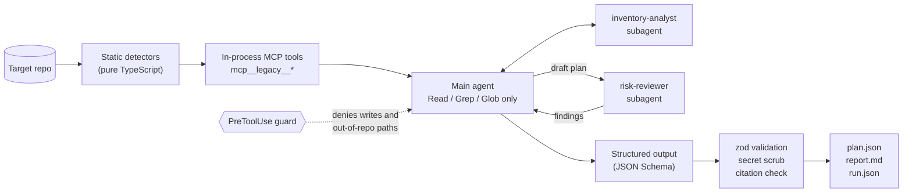

# legacy-migration-agent

Point a read-only Claude agent at a legacy codebase and get back a migration and decommission plan in which every claim cites a file and line.

[](https://github.com/cBoulio/legacy-migration-agent/actions/workflows/ci.yml)

```
legacy-migrate analyze ./path/to/repo --target "Node 22 + Postgres on Cloudflare Workers" --out report/
```

Retiring an old application is mostly archaeology. You need to know what calls it, what it calls, where its data lives, which jobs run at 2 a.m., and what breaks if you switch it off. This tool does the mechanical part of that with deterministic static analysis. A Claude agent built on the [Claude Agent SDK](https://code.claude.com/docs/en/agent-sdk/overview) then reads the code and writes the plan. A reviewer subagent checks the draft against the source, and the output is a schema-validated JSON plan with a Markdown report generated from it.

**Sample output:** [examples/legacy-invoicing/sample-report.md](examples/legacy-invoicing/sample-report.md) comes from a real run against the fictional PHP invoicing app in [examples/legacy-invoicing/app](examples/legacy-invoicing/app). [plan.json](examples/legacy-invoicing/plan.json) is the agent's structured output, unedited, and the report is rendered from it. [run.json](examples/legacy-invoicing/run.json) has the telemetry: 27 turns, 398 seconds, an SDK-estimated cost of $1.40, both subagents invoked, 201 of 201 citations verified, and no tool calls denied.

On that small fixture the agent found what the detectors alone cannot. It noticed that the late-fee job compounds every night, that nothing in the repo creates invoices (so some outside system writes to the database), and that the charge endpoint never sets `updated_at`, which means the ERP feed never shows an invoice as paid. The reviewer subagent caught 17 problems in the draft, including a rollback that would re-run the late-fee job on the same day. Each one is listed at the end of the report with how the plan changed.

## How it works



1. **Deterministic inventory.** The repo is read once and six detectors run over it: dependencies (package.json, composer.json, requirements.txt, pom.xml, script tags, missing lockfiles), entry points (served pages, routes, rewrite rules, CLI scripts), data stores (drivers, connection settings, tables from SQL, which tables code reads and writes, local file storage), scheduled jobs (crontabs with a plain-English schedule, in-process schedulers, k8s/systemd timers), external integrations (HTTP/SOAP clients, email and payment providers, browser calls, firewall allowlists), and hard-coded configuration (credential keys with values redacted).
2. **Tools, not guesses.** Those results are exposed to the agent as in-process MCP tools (`createSdkMcpServer` / `tool()`). They take no arguments, so the model cannot point them anywhere else.
3. **Agent loop.** The main agent calls every tool, delegates consumer and integration tracing to an `inventory-analyst` subagent, reads the files itself, and drafts the plan.
4. **Review.** The draft goes to a `risk-reviewer` subagent that opens each cited file, flags unsupported claims and missing risks, and checks that each phase's rollback would work. The agent revises and records each finding in `reviewNotes`.
5. **Validated output.** The SDK enforces a JSON Schema generated from a zod schema. The CLI parses the result with zod again, removes any secret values copied from the repo, checks every citation against the files on disk, and renders `report.md` from the JSON.

## Quick start

Requires Node 22.

```bash
git clone https://github.com/cBoulio/legacy-migration-agent.git
cd legacy-migration-agent
npm ci
npm run build

# No model, no credentials: print the deterministic inventory
node dist/cli.js analyze examples/legacy-invoicing/app --dry-run

# Full run (uses the model; see Authentication)
node dist/cli.js analyze examples/legacy-invoicing/app --out report/

# Re-render report.md from an edited or saved plan.json, no model
node dist/cli.js render examples/legacy-invoicing/app --out report/
```

Options:

| Flag | Default | Purpose |
|---|---|---|
| `--target <text>` | `Node 22 + Postgres on Cloudflare Workers` | Platform you are moving to |
| `--out <dir>` | `report` | Where `plan.json`, `report.md`, `run.json`, `inventory.json` go |
| `--dry-run` | off | Deterministic analysis only |
| `--json` | off | With `--dry-run`, print the inventory as JSON |
| `--model <name>` | Claude Code's default | Model alias or ID |
| `--max-turns <n>` | 60 | Turn limit for the agent |
| `--max-budget-usd <n>` | 5 | Stop the run when estimated spend reaches this |

`npm link` installs the `legacy-migrate` command globally if you prefer it to `node dist/cli.js`.

## Output

| File | Contents |
|---|---|
| `plan.json` | The plan. Validated against [`src/plan/schema.ts`](src/plan/schema.ts): summary, inventory, integrations and consumers, data migration steps with verification, phased cut-over with rollback per phase, decommission checklist, risks, open questions, reviewer findings. Every item has an `evidence` array of `{ path, line? }`. |
| `report.md` | Rendered from `plan.json`. Citations link to the file and line. |
| `run.json` | Turns, duration, estimated cost, per-model token usage, tool-call counts, subagent calls, guard denials, citation check results, secrets scrubbed. |
| `inventory.json` | The deterministic inventory the agent started from. |

## Design decisions

**Read-only, enforced twice.** The agent gets `Read`, `Grep`, `Glob`, the subagent launcher, and its own MCP tools. `Bash`, `Write`, `Edit`, `WebFetch`, and the rest are removed from the session with `disallowedTools`, and the permission mode is `dontAsk`, so anything not pre-approved is refused rather than prompted. Independently, a `PreToolUse` hook ([`src/agent/guard.ts`](src/agent/guard.ts)) checks every tool call, including calls made inside subagents. It denies any tool not on the allowlist, any path that resolves outside the target repo (symlinks included), absolute or `..` glob patterns, and reads of likely secrets files such as `.env` and `*.pem`. Denials are logged to `run.json`. The check is a hook rather than `canUseTool` because the SDK skips `canUseTool` for calls that an allow rule has already approved; hooks run first for every call. The session also ignores the user's settings, the target repo's `.claude/` directory, other MCP configs, and claude.ai connectors (`settingSources: []`, `strictMcpConfig`, `disableClaudeAiConnectors`), so nothing outside this tool can widen what the agent can do.

**Deterministic tools over model guesses.** Dependency versions, cron schedules, table names, and which file writes which table are facts a parser can get right every time. The model starts from those facts and spends its effort on judgment: sequencing, risk, and what the code does not say. The detectors are plain functions with unit tests against the fixture.

**Evidence citations, checked.** The schema requires at least one citation on every component, integration, step, phase, checklist item, risk, and open question. After the run, [`src/plan/verify.ts`](src/plan/verify.ts) confirms each cited file exists inside the repo and each line number is in range. The report states how many citations passed and lists any that failed.

**Schema-validated output.** The plan schema is written once in zod. It is converted to JSON Schema (draft-07) for the SDK's `outputFormat`, so the agent is re-prompted until its output fits, and then parsed with zod again before anything is written. The Markdown report is a pure function of the JSON, so the two cannot disagree.

**Secrets stay out of reports.** Detectors return credential key names and locations, never values. The model is told not to repeat values, and the CLI also removes every literal secret value found in the repo from the plan before writing it. `run.json` records how many were removed.

**Cost telemetry.** `run.json` records `num_turns`, `duration_ms`, `total_cost_usd`, and per-model usage from the SDK's result message, plus tool-call counts. `--max-budget-usd` maps to the SDK's `maxBudgetUsd`, and subagent nesting is capped at one level. The SDK documents the cost as a client-side estimate, not a bill.

## Authentication

The Agent SDK runs the Claude Code engine, which ships as a native binary inside the npm package. It authenticates the same way Claude Code does.

- **Your own machine, your own use.** If you are logged in to Claude Code, the SDK can use that login. The sample in this repo was produced that way, and `run.json` shows `apiKeySource: "none"` for that reason.
- **Anything shared, hosted, or run for other people.** Set `ANTHROPIC_API_KEY` from the [Claude Console](https://platform.claude.com/), or use Amazon Bedrock, Google Cloud, or Microsoft Foundry through `CLAUDE_CODE_USE_BEDROCK`, `CLAUDE_CODE_USE_VERTEX`, or `CLAUDE_CODE_USE_FOUNDRY`. Anthropic's documentation says that, unless previously approved, third-party developers may not offer claude.ai login or rate limits in their products, including agents built on the Agent SDK. Use API key authentication for those cases.
- **CI.** The workflow only builds, tests, and runs `--dry-run`, so it needs no credentials.

The SDK reads the key from the process environment; it does not load `.env` files.

## Limits

- Detectors are regex and manifest parsing, not a full parser per language. They are tuned for common shapes in PHP, Node, Python, and Java codebases and will miss unusual patterns. The agent reads the code to fill gaps, and its claims are only as good as its citations.
- Inbound consumers that leave no trace in the repo (another team calling an endpoint, a report that reads the database directly) cannot be found by reading code. The plan lists them as open questions; confirm them from access logs and with the owning teams.
- Data volume, downtime tolerance, and business rules are not in the code. The plan is a starting point for the people who own the system, not a runbook to execute unreviewed.
- Large repos are capped at 5,000 files and 512 KB per file for the deterministic pass. The agent can still read beyond that with its own tools.
- A full run costs real money on an API key. The sample run's cost is in [run.json](examples/legacy-invoicing/run.json).

## Development

```bash
npm run lint    # typecheck src and tests
npm test        # vitest: detectors, read-only guard, schema, citation check, rendering (no model calls)
npm run build
```

The fixture in `examples/legacy-invoicing/app` is fictional. Its hosts use `.example` domains and its credentials are fake.

## License

MIT. See [LICENSE](LICENSE).
